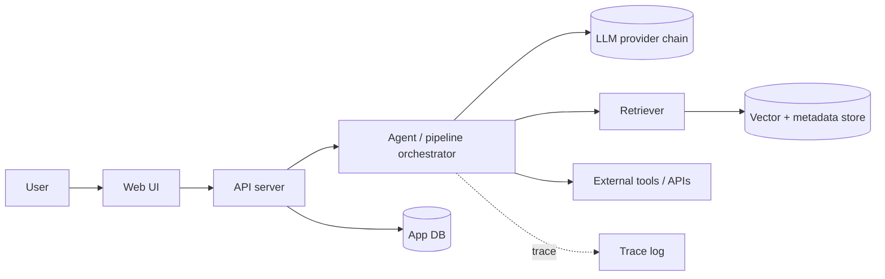

# 04 - Architecture and stack

Goal: choose the simplest architecture that makes the **one deep technical component** real and the demo reliable.

## Contents
- Principles
- Archetypes with reference architectures
- Stack selection procedure
- Depth signals judges verify
- Anti-patterns
- Architecture document

## Principles
1. **Monolith first.** One repo, one deployable, one language where possible. No microservices, no Kubernetes, no message bus unless the idea *is* that.
2. **One deep component, everything else boring.** Build one component genuinely (retrieval pipeline, agent loop, model fine-tune, sensor fusion, protocol). Use managed, boring tech for the rest.
3. **Deterministic golden path.** Seed data, cached responses, feature flags, fixed demo account. The demo never depends on luck.
4. **Provider-abstracted AI.** All model calls through one thin client (OpenAI-compatible base URL where possible) so you can fail over (`05-harness.md`).
5. **Observability from day one.** Request IDs, structured logs, a trace panel you can show.
6. **Evidence of engineering.** Tests for the golden path, an eval set, a measured number (accuracy, latency p95, cost per request).

## Archetypes
Pick the closest; adapt. Defaults below are *starting points to verify with research*, not mandates.

### A. AI web app with retrieval/agents

Default: TypeScript or Python full-stack, hosted DB with vector support or embedded store, one orchestrator module, streaming responses.

### B. Agentic workflow automation
Trigger (webhook/schedule/inbox) to planner to tool executor to verifier to human-approval step to result. The differentiator is **reliability**: schema-validated tool calls, retries, idempotency, audit log. Demo: real integration firing on a real trigger.

### C. Real-time / voice / streaming
Audio or event stream to STT/stream processor to model to TTS/UI. Budget latency per hop; show end-to-end p50/p95. Use WebSocket/SSE; keep a pre-recorded fallback.

### D. Mobile / PWA
PWA first (one codebase, instant deploy, installable); native only if a device API is the core (camera pipeline, sensors, BLE). Cross-platform framework when native is required. Always ship an installable artifact link plus a screen-recorded fallback.

### E. Data / ML application
Dataset to pipeline to model/baseline to evaluation to UI. A **baseline comparison and evaluation table are mandatory**. Use notebooks for exploration, a script for reproduction, a minimal UI (Streamlit/Gradio-class) if UI is not heavily scored.

### F. Hardware / IoT
Sensor/actuator to microcontroller/SBC to local broker/HTTP to cloud/UI. Test every part in the first 10% of time; write a mock device so software work never blocks on hardware; bring spares; record a backup video.

### G. Developer tool / CLI / browser extension / MCP server
Fast to build, easy to demo, easy to judge. Ship installable in one command; include a sample project. Extension store review takes time, so distribute an unpacked build.

### H. Web3
Testnet, verified contract, minimal on-chain surface, off-chain indexing for UI, one real transaction in demo, document security assumptions.

## Stack selection procedure
1. List the **capabilities** needed (UI, API, DB, auth, AI, storage, realtime, deploy).
2. For each, prefer what the team already knows. Familiarity beats novelty under time pressure.
3. Research current free tier and limits (Research Gate, lens L7) for each non-trivial service.
4. Keep the **fewest** vendors. Each vendor is an account, a key, a limit, and a failure mode.
5. Define a fallback for each external dependency.
6. Record the choice in one ADR line: `Decision | Alternatives | Why | Revisit trigger`.
Tool lists and selection rules: `11-tool-arsenal.md`. Cost rules: `10-student-cost-optimizer.md`.

## Depth signals judges can verify
Own retrieval/agent code rather than a black-box call | structured outputs validated by schema | evals with numbers | caching and rate-limit handling | tracing visible in UI | tests in CI | reproducible run script | threat/privacy notes | honest limitations section.

## Anti-patterns
- A single prompt in a UI called "AI".
- Six services glued together nobody understands.
- Auth, billing, admin panels, settings pages (not scored, cost hours).
- Training a model from scratch when fine-tuning, prompting, or a classical baseline will do.
- Live demo depending on a single free-tier key.
- Architecture diagram showing components that do not exist (see `15-integrity-and-rules.md`).

## Architecture document
Template: `assets/templates/architecture-doc.md`. Include: context diagram, component diagram, data flow with protocols, tech choices with ADR lines, failure and fallback table, limits and cost table, what is real vs mocked.
