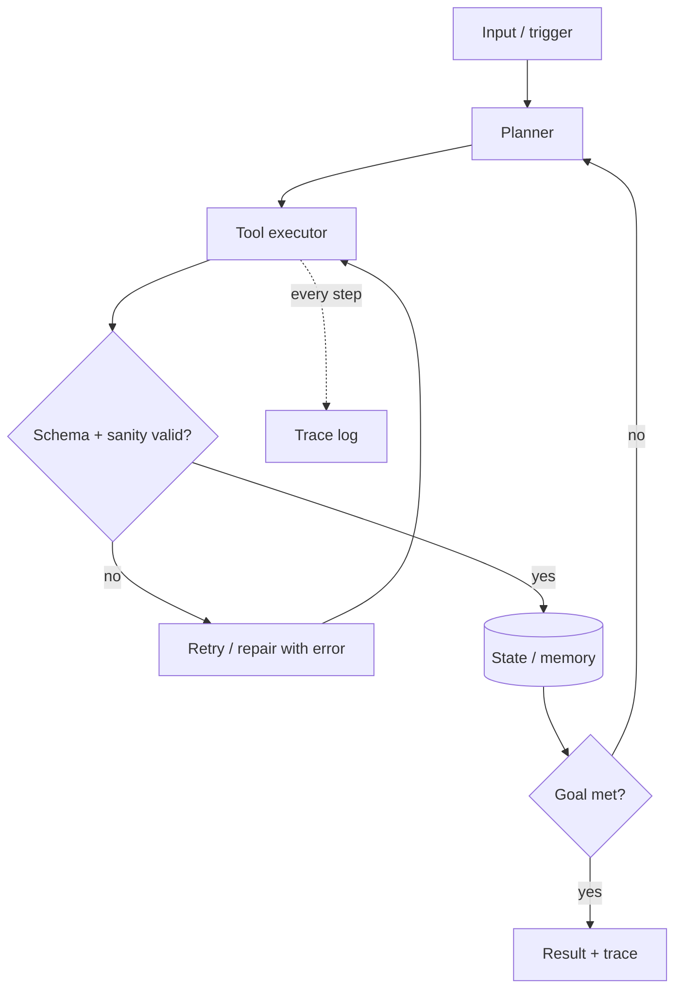

# 05 - Harness: build harness, runtime agent harness, eval harness

"Harness" means three different things in a hackathon. Cover all three when relevant.

## Contents
1. Build harness (how the team builds fast with AI coding agents)
2. Runtime agent harness (the loop inside the product)
3. Eval and test harness (proof it works)
4. Demo-day harness

## 1. Build harness
Purpose: a repo and agent setup that lets 1-5 people ship vertical slices without stepping on each other, at near-zero cost.

**Bootstrap in the first 30-60 minutes**
- Repo with `AGENTS.md` (commands to run/test/lint, architecture in 10 lines, conventions, "do not touch" paths, definition of done). Most coding agents read `AGENTS.md`; add a thin `CLAUDE.md` pointing to it if needed.
- One-command scripts: `make dev`, `make test`, `make demo`, `make seed`.
- `.env.example`, secrets only in env, `.gitignore` before first commit.
- CI that runs lint + smoke test (free tier of the Git host).

**Agent workflow**
1. Spec: write `SPEC.md` (user flow, acceptance tests) before code.
2. Plan: vertical slices, each ending in something runnable.
3. Implement slice by slice; run tests after each; commit small.
4. Parallelize by **directory ownership** (one agent/person per area) or separate git worktrees/branches; merge to trunk at least every 1-2 hours.
5. Context hygiene: short `AGENTS.md`, point to files rather than pasting; start fresh sessions per slice.
6. Test-first for the golden path; agents must run the test before claiming done.

**Cost control**
- Use a free/cheap model for bulk edits and boilerplate; reserve the strongest model for planning, architecture, and hard bugs. Verify what is currently free (`10-student-cost-optimizer.md`, `scripts/cost_estimate.py`).
- Cap agent loops (iterations and spend), review diffs, avoid giant context dumps.
- Student programs and sponsor credits often include coding-agent access; research current offers (L7).

**Guardrails**: never let an agent commit secrets, run destructive commands on shared resources, or add dependencies without a note. Pin dependency versions that are at least two weeks old when possible.

**MCP/tooling worth connecting (if available and free)**: Git host, browser automation for UI tests, documentation lookup, database inspector, design tool. Add only what removes a manual step.

## 2. Runtime agent harness (inside the product)

Checklist:
- **Tool schemas** strict; validate model output against the schema; repair loop with bounded retries.
- **Bounded loops**: max steps, max tokens, wall-clock timeout, per-tool timeout.
- **Idempotent tools**; confirm before side effects; audit log.
- **Provider chain**: primary model, secondary provider, small local/cheap fallback; same client interface; handle 429 with backoff and queueing.
- **Caching**: hash(prompt+params) to response for demo inputs; replay mode for demo day.
- **Grounding**: retrieval with citations or tool results shown to the user.
- **Memory**: only what the demo needs; otherwise stateless.
- **Trace panel**: show steps, tool calls, latency, tokens; it doubles as technical-depth evidence.
- **Safety**: input sanitization, prompt-injection awareness for any tool that reads external content, no real PII.

## 3. Eval and test harness
- **Golden set**: 10-30 representative inputs with expected outputs or rubric checks. Report accuracy/pass-rate, latency p50/p95, cost per request.
- **Baseline**: naive approach (single prompt, keyword search, rule-based). Show your system beating it with a number.
- **LLM-as-judge** only with a fixed rubric and spot-checked samples; label it as such.
- **Record/replay** of external calls so tests are fast, free, and deterministic.
- **Smoke test** (`make smoke`): hits the deployed URL and runs the golden path; run it before every deploy and at preflight.
- **Failure injection**: simulate 429, timeout, empty result; confirm the fallback path works.

## 4. Demo-day harness
`make demo` seeds data, starts services, warms caches, runs the smoke test, prints the demo URL. A `DEMO_MODE=replay` flag serves cached responses if providers fail. Details: `09-demo-engineering-and-qa.md`.
