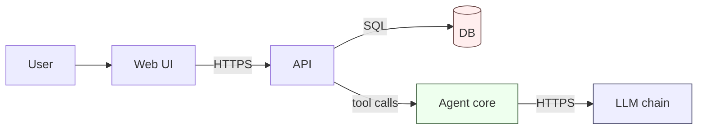
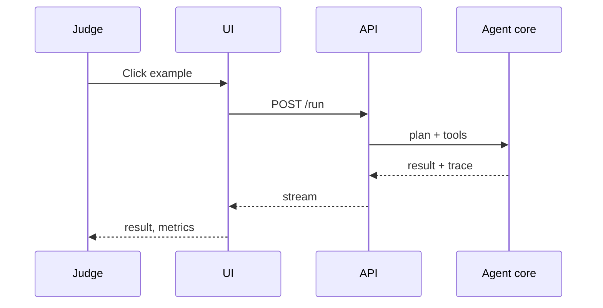
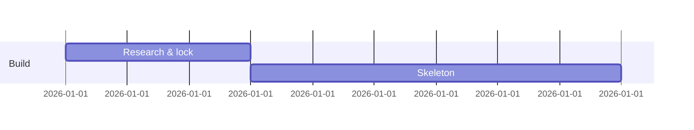

# 12 - Diagram library

Rule: include at least one Mermaid diagram whenever you explain architecture, flow, timeline, or a decision. Ready-made sources: `assets/diagrams/*.mmd`.

## Contents
- Which diagram for which question
- Style rules
- Snippets
- Rendering fallbacks

## Which diagram
| Question | Diagram |
|---|---|
| What are the parts? | Component flowchart (`architecture-layered.mmd`) |
| How does data move? | Data-flow flowchart with protocol labels (`data-flow-rag.mmd`) |
| What happens in the demo? | Sequence diagram (`sequence-demo.mmd`) |
| How does the agent loop work? | Flowchart with validation loop (`agent-loop.mmd`) |
| What is the schedule? | Gantt (`gantt-48h.mmd`, or `timeline.py`) |
| Which idea/choice? | Decision flowchart (`idea-court-flow.mmd`) |
| What if a provider fails? | Fallback chain (`fallback-chain.mmd`) |
| Data model? | ER diagram |
| User path? | Journey or state diagram |

## Style rules
- <= 12 nodes; split if larger.
- Label edges with the protocol or payload (HTTP, SSE, SQL, embeddings).
- Distinguish external, AI, data, user via `classDef`.
- Mark mocked components with a dashed border and the word `mock`.
- Show fallbacks and failure paths on reliability diagrams.
- Left-to-right for flows, top-down for hierarchies.
- No decorative nodes.

## Snippets
Layered architecture with classes:

Demo sequence:

Gantt:

## Rendering fallbacks
If the host does not render Mermaid: (1) use the host's visual/artifact tool if present; (2) otherwise provide the Mermaid source plus a compact ASCII version of the main architecture; (3) tell the user they can paste the source into any Mermaid renderer. Never skip the diagram because rendering is uncertain.
